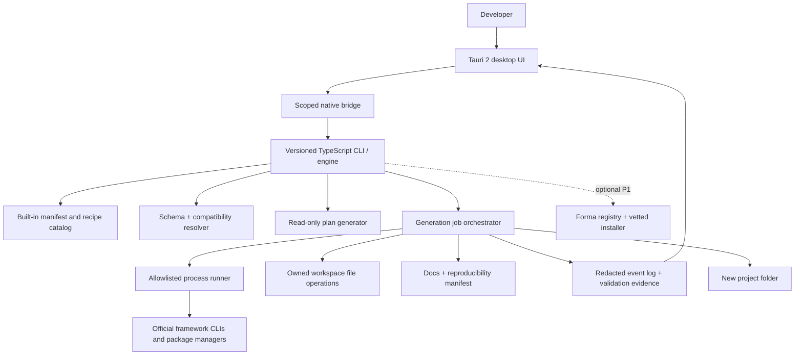
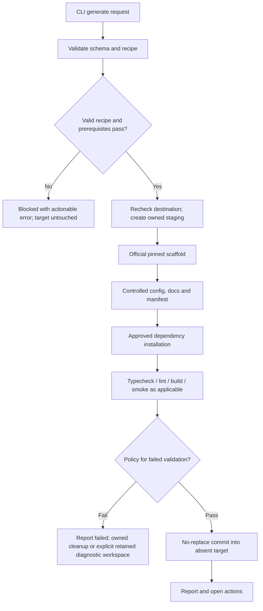

# Architecture — Universal Project Generator Desktop

| Field | Value |
|---|---|
| Version | V1 design draft 0.2 |
| Date | 2026-11-13 |
| Status | **Design draft; Phase 01 CLI, Phase 02.6 runtime PoC, and Phase 03 internal UI MVP implemented; architecture/release review pending** |
| Product baseline | [PRD](PRD.md) |
| Interface contract | [Adapter Contract](adapters/adapter-contract.md) |
| Compatibility source | [Compatibility Matrix](adapters/compatibility-matrix.md) |
| UX | [Design Specification](../design.md) |
| Decisions | [Decision Register](decisions/index.md) |

## 1. Goals and scope

Build a **Windows-first, local-first, CLI-first** project generator whose desktop app is a thin, secured client. Generate new repositories, never modify existing user projects. Technology choice is extensible through **versioned, built-in, reviewed adapters**; a catalog entry does not imply an executable recipe. One verified recipe is the unit of product availability and release qualification.

### Architecture invariants

1. Pure read-only `resolve/plan` must not run external commands, create directories, fetch network data, or access secrets.
2. Explicit `generate` intent is mandatory before any write/install/process operation. User sees the sanitized plan and prerequisites first.
3. No destructive overwrite. The final destination must be absent. No operation may clean files that lack generator ownership evidence.
4. Every official scaffold command uses an **exact resolved/pinned version** and explicit argv; package ecosystem is maintained per language. Do not use `@latest` as an effective execution pin.
5. One recipe = an explicit combination of adapters, options, support status, limitations, and evidence references; compatibility of ingredients alone is not sufficient.
6. Template providers, including Forma, are separate products. Reuse vetted installer contracts; no arbitrary remote plugin execution in V1.
7. Errors, skips, partial outcomes, and unverified toolchains must be reported truthfully.
8. UI cannot construct arbitrary executable names, shell snippets, or file writes. All privileged host operations pass through a validated bridge.

## 2. System context



Phase 1 ships **Engine + CLI + built-in recipes** independently and remains testable without Tauri. Phases 02.6–03 add an internal Tauri client; implementation must never turn the UI into an unstructured shell-command frontend.

### Current implementation and evidence snapshot

Phase 05A adds BE-01 as a standalone Express/TypeScript/npm built-in starter through the existing staged CLI/Tauri path; BE-01 remains database-free. Phase 05B adds BE-02 as a standalone Go standard-library `net/http`/Go Modules starter through that same path. Phase 05C.1 adds planned BE-06 as standalone FastAPI/Pydantic/Uvicorn + uv, with no database/ORM/auth/fullstack. BE-06 checks pyproject identity through the native supervisor, resolves a lock, and requires explicit unsandboxed build-code consent. Phase 05C.2 passed bounded local toolchain-provenance, CLI, and native Tauri checks using isolated CPython 3.14.10 and uv 0.13.8; direct pins and independent recipe acceptance remain open. Phase 05D.1 adds planned standalone BE-03 NestJS + npm using an integrity-pinned official Nest CLI and bounded CLI/native evidence; no DB/ORM/auth/Docker/fullstack or Observe integration. Phase 05D.2 adds planned standalone BE-04 Go + Gin `1.12.0` + Go Modules with a pinned graph; bounded Windows CLI/native acceptance passed, including separate module-download consent, integrity, Go checks, HTTP/shutdown, cancellation, cleanup, and collision. Phase 06A adds planned BE-07 as separate Express + npm + SQLite + Drizzle. Generation writes schema and migration SQL only; startup and health routes do not open/create the configured application DB, first CRUD use opens it lazily, and migration remains explicit via `npm run db:migrate`. Runtime and Drizzle config share project-relative DB_FILE validation; Node `lstat`/`realpath` remains defense-in-depth. Windows path validation uses first-party Rust `pg-db-path-verifier.exe`: `CreateFileW`, handle-relative `NtCreateFile` with `FILE_OPEN_REPARSE_POINT`, and `GetFileInformationByHandleEx(FileAttributeTagInfo)`. Native supervisor copies packaged helper into owned BE-07 staging; Tauri system/bundled resource staging includes it. Generated code resolves helper from its module URL to an absolute path, fixed argv, JSON stdin, and `shell: false`; no PowerShell fallback or `SystemRoot`/`WINDIR`/PATH/CWD-based executable selection. Helper is replaceable by someone who can modify generated project files. Reparse detection covers only components observed during handle walk; TOCTOU remains before SQLite open, and hard-link aliases are not detected. File-symlink test remains `NOT VERIFIED` (`EPERM`); npm lifecycle scripts remain unsandboxed. Lifecycle scripts remain unsandboxed. All backend recipes remain planned and release-profile blocked. Go, Gin, FastAPI, NestJS, and BE-07 HTTP smoke servers are stopped before finalization; none remains running after generation. See [Phase 05A evidence](qa/evidence/phase-05a-express-rest-api.md), [Phase 05B evidence](qa/evidence/phase-05b-go-net-http.md), [Phase 05C.1 evidence](qa/evidence/phase-05c1-fastapi.md), [Phase 05C.2 evidence](qa/evidence/phase-05c2-fastapi-toolchain-native.md), [Phase 05D.1 evidence](qa/evidence/phase-05d1-nestjs.md), [Phase 05D.2 evidence](qa/evidence/phase-05d2-go-gin.md), and [Phase 06A evidence](qa/evidence/phase-06a-express-sqlite-drizzle.md).

Current repository implements three npm workspaces: `packages/core` owns schema/resolution, plans, doctor, generation jobs, process execution, staging and project docs; `packages/cli` owns command parsing and JSON/JSONL output; `packages/desktop` owns the React/Vite UI and Tauri shell. The UI provides dashboard, catalog-driven wizard, planned Express (BE-01 database-free and BE-07 SQLite/Drizzle), Go `net/http`, Go Gin, NestJS, Laravel, and FastAPI backend choices, read-only review, separate consent where required, progress/results, local metadata history/settings, and fixed native open actions. The Tauri host writes bounded temporary JSON config, launches only the packaged CLI under a build-selected Node runtime, validates versioned JSONL events, and forwards restricted cancellation. Recipe evidence remains local and does not qualify a recipe. System-Node and bundled-Node NSIS installers were built; same-host Windows 11 per-user install/update/uninstall and launch checks passed. Clean-machine proof remains unavailable. Forma remains separate and unmodified. FE-01–FE-15/BE-01–BE-07/FM-01/FM-02 remain `planned`; release-profile generation blocks them. Debug-only planned override is evidence gathering, not support status. See [Phase 02 evidence](qa/evidence/phase-02-forma-local-integration.md), [Phase 02.6 evidence](qa/evidence/phase-02.6-desktop-runtime-packaging.md), [Phase 03 evidence](qa/evidence/phase-03-desktop-ui-mvp.md), [Phase 04A evidence](qa/evidence/phase-04a-vue-bootstrap-expansion.md), [Phase 04B evidence](qa/evidence/phase-04b-nuxt-angular.md), [Phase 04B.2 evidence](qa/evidence/phase-04b2-scss-tailwind.md), [Phase 04B.3 evidence](qa/evidence/phase-04b3-yarn-pnpm.md), [Phase 05B evidence](qa/evidence/phase-05b-go-net-http.md), [Phase 05C.1 evidence](qa/evidence/phase-05c1-fastapi.md), [Phase 05D.1 evidence](qa/evidence/phase-05d1-nestjs.md), [Phase 05D.2 evidence](qa/evidence/phase-05d2-go-gin.md), and [Phase 06A evidence](qa/evidence/phase-06a-express-sqlite-drizzle.md).

Phase 06B adds BE-08 as a separate planned Express + npm + PostgreSQL 16+ + Drizzle recipe. The desktop exposes its exact database/ORM tuple and Tauri maps it to core schema. Generation/startup/health remain DB-free; explicit migration uses guarded `--target host:port/database` and connected-identity preflight. Pin checks, focused tests, and packaged release-policy checks passed. E2E harness startup and smoke environment issues were fixed without widening generic runner policy; generated migration identity now compares bare host from `host(inet_server_addr())`. Targeted disposable PostgreSQL E2E passed generation, smoke, migration, CRUD, rollback, cancellation and collision. Existing PostgreSQL service remained untouched. Phase 06B remains **NO-GO pending independent acceptance**; BE-08 planned and public release **NO-GO**. See [Phase 06B evidence](qa/evidence/phase-06b-express-postgresql-drizzle.md).

## 3. Proposed repository boundaries

```text
project-generator/
├── apps/
│   └── desktop/                 # Later: Tauri shell, React wizard, settings, job console
├── packages/
│   ├── config/                  # Shared schema, normalization, config migration
│   ├── catalog/                 # Built-in adapter and recipe manifests, release metadata
│   ├── core/                    # Resolver, plan, events, job state, staging/finalize
│   ├── adapters/                # Reviewed bundled framework/toolchain adapters
│   ├── cli/                     # CLI entrypoint: plan, doctor, generate, inspect
│   └── docs-generator/          # Generated docs templates and evidence-aware content
├── tests/
│   ├── unit/
│   ├── integration/
│   └── windows/                 # Path, cancellation, cleanup, real-scaffold evidence
├── docs/
│   ├── PRD.md
│   ├── ARCHITECTURE.md
│   ├── ROADMAP.md
│   ├── adapters/
│   ├── decisions/
│   ├── qa/
│   └── implementation/
├── AGENTS.md
├── agent.md
├── decision.md
└── design.md
```

This remains the **proposed future directory shape**. Current root npm workspaces are `packages/core`, `packages/cli`, and `packages/desktop`; config, catalog, adapters, and docs generation live within `core`. The root internal and generated-project package manager is npm. Do not infer that proposed packages or desktop capabilities beyond the implemented Phase 03 UI scope exist.

### Package responsibilities

| Package | Owns | Must not do |
|---|---|---|
| `config` | Versioned schemas, parsing and normalization | Access disk/network or launch processes during schema validation |
| `catalog` | Adapter metadata, recipe status, version pin maps | Assume arbitrary cartesian combinations supported |
| `core` | Resolve → plan → preflight → execute, file ownership, jobs | Hardcode a framework's install commands into generic orchestration |
| `adapters` | Framework-specific steps, artifacts and checks | Delete other adapter files or invoke arbitrary unregistered commands |
| `cli` | Parsed subcommands, JSON output, exit codes, redaction | Contain product business logic |
| `docs-generator` | Real stack-specific docs and reproducibility metadata | Fabricate approval history, passing QA results or working DB connections |
| `desktop` | View/state, user intent, scoped OS host bridge | Execute user-supplied shell code directly |

## 4. Logical domain model

- `ProjectSelectionV1`: user-entered choices; untrusted until schema validated.
- `AdapterManifestV1`: versioned bundled capability and prerequisites metadata.
- `RecipeManifestV1`: explicit allowed combination, expected files, compatibility status, QA evidence, platform.
- `ResolvedSelection`: canonical, immutable combination of normalized choices and exact adapter versions.
- `GenerationPlan`: serializable steps, pinned scaffold sources, expected paths, optional downloads, consent flags, warnings; no secrets.
- `EnvironmentReport`: discovered executable versions and missing tools (read-only inspection with bounded command probes).
- `GenerationJob`: single owned execution, phase/event stream, cancellation signal, staging ownership marker.
- `JobReport`: step outcome, validation outcome, cleanup status, target impact and recovery instructions.
- `ReproducibilityManifest`: recipe ID and version, exact resolved upstream versions/hashes, package managers, actual generated lockfiles, validation statuses, no machine secrets.

The [Adapter Contract](adapters/adapter-contract.md) defines the broader proposed model. Phase 01's canonical types and strict parser live in `packages/core/src/types.ts` and `packages/core/src/schema.ts`; the CLI uses them directly. The desktop accepts a smaller Rust-deserialized selection enum, bounds user strings, then relies on the CLI's canonical parser/resolver; UI validation is not a trust boundary.

## 5. Execution protocol

### 5.1 Commands and invocation

Phase 01 CLI interface (implemented):

```text
project-generator catalog --json
project-generator plan --config <path> --json
project-generator doctor --config <path> --json
project-generator generate --config <path> --jsonl [--development-allow-planned]
project-generator inspect --output <path> --json
```

The desktop additionally invokes `generate --desktop-control` and may append `--development-allow-planned` only in debug builds. Its fixed Tauri commands include `get_catalog`, `get_runtime_status`, `get_vscode_status`, `resolve_plan`, `run_environment_doctor`, `inspect_recovery`, `start_generation`, `cancel_generation`, `open_project_folder`, and `open_project_in_vscode`; no generic command or shell API exists.

- `catalog`: built-in metadata only, no network.
- `plan`: schema validate, resolve recipe, render immutable plan and expected output; **no filesystem modification and no external execution**, with optional strictly read-only local config file read.
- `doctor`: inspect the active Node runtime, npm CLI beside it, platform and target-path safety. No installs, subprocess probes or target changes in Phase 01.
- `generate`: revalidate config and destination immediately before execution; ask for explicit execution intent at the UI layer or CLI invocation; emit streaming structured job events. `generate` is allowed to create its own staging workspace and use official package tooling.
- `inspect`: read generator-owned output metadata without modifying the generated project; do not infer build readiness from metadata alone.

CLI output contract: a stable JSON error envelope for JSON mode and newline-delimited event records for generation; diagnostics go to stderr in readable mode. Standard exit categories should distinguish invalid selection, missing prerequisite, generation failed, validation failed, cancelled, and blocked destination. Version these contracts and test consumer resilience.

### 5.2 Pipeline



The exact order of documentation and dependency operations may differ by recipe, but event semantics and destination safety are invariant. **No output is labeled Ready if required checks fail.** For Phase 1, validation failure defaults to **not committing** the new target; preserve redacted logs outside staging, clean only owned staging, and provide retry guidance. Diagnostic staging retention is optional and opt-in later.

### 5.3 Ownership and finalization

Target example: `E:\Projects\my-app`; parent must exist and user must have access. Proposed staging layout **on same volume**:

```text
E:\Projects\
├── .project-generator-stage-<random>/
│   ├── .ownership.json         # job UUID and owned path marker
│   └── my-app/                 # official scaffold uses real project name
└── my-app/                    # MUST be absent until successful commit
```

- Verify destination absent before stage and **again just before commit**.
- Phase 01.7 uses the native helper to open local-drive paths relative to retained directory handles, reject reparse points/volume changes, and perform no-replace finalization by handle. Ordinary Node writes into staging remain path-based; native race tests still need non-elevated execution and independent review.
- A staging marker alone is not authority to delete arbitrary contents: ownership must match the exact canonical staging path, job UUID and creation record; guard against swapped junctions/symlinks.
- Recheck path boundaries and canonicalization before mutating files. No `..` traversal, drive-root target, reserved Windows names, or reparse-point escape.
- Cancellation/crash must not erase preexisting user directories. Report orphan staging cleanly; never auto-delete unverified folders.
- A cross-volume rename is not assumed atomic; keep stage under chosen target's parent. Failure to create a safe same-volume stage blocks generation.

### 5.4 Process execution and cancellation

- Registry-controlled executable identity + argv list, not concatenated shell strings; whitelist permitted env keys, set controlled cwd, redact logs.
- Phase 01 resolves npm's CLI JavaScript under the active Node installation, then invokes reviewed JavaScript entrypoints through `node` with explicit argv and `shell: false`; executable and cwd roots are checked and the child environment is reduced.
- Phase 01.7 delegates Windows workload creation and cancellation to the Rust helper: child starts suspended, enters a Job Object before resume, and termination is confirmed against the active job. There is no PID/`taskkill` fallback. Process integration tests and independent security review remain open; see proposed [DEC-014](decisions/DEC-014-windows-process-runner.md) and [DEC-015](decisions/DEC-015-windows-native-safety-boundary.md).
- Secret values remain in private runtime memory / secure store, never argv or logs when the tool accepts safer mechanisms.
- Lifecycle scripts in dependency packages can execute code: disclose at Review and provide no false 'sandboxed' claim.
- Network access occurs only in generation or explicitly requested registry sync, not in plan.

### 5.5 Configuration and provenance

Sample **illustrative** user selection:

```json
{
  "schemaVersion": 1,
  "project": { "name": "sample-web", "type": "frontend", "parentDirectory": "E:\\Projects" },
  "frontend": { "adapterId": "frontend.react-vite", "language": "ts", "manager": "npm" },
  "styling": { "adapterId": "styling.css" },
  "documentation": "minimal",
  "git": { "initialize": false, "initialCommit": false }
}
```

The example follows the proposed `ProjectSelectionV1` shape; the resolver derives `FE-01` from the selection and the reviewed recipe registry. Concrete adapter IDs must be reconciled to implemented manifests before CLI usage. Persist no user secrets, auth tokens, or generated `.env` values. A project artifact such as `.project-generator/manifest.json` captures generator version, recipe ID, selected values, resolved versions and check outcomes; do **not** write absolute private home paths or credentials.

## 6. Adapter architecture and compatibility

Use one stable manifest per adapter + one reviewed recipe manifest per releaseable configuration. Resolution steps:

1. Validate project type and schema.
2. Map selected framework(s) to bundled versioned adapters.
3. Validate target OS and exact pinned CLI versions.
4. Validate npm default (Node ecosystem); Go Modules / Composer / uv remain independent.
5. Validate styling and component choices; Bootstrap is web-only, Expo/Flutter use native styling.
6. Validate DB/ORM/driver combinations and service provisioning mode.
7. If Forma selected, resolve only a pinned catalog template and tested framework mapping; fetch/cache only during explicit generation; invoke the existing exporter/installer and verify its SHA-256 manifest. Hashes do not establish publisher identity.
8. Resolve to a named recipe with a QA-backed support state; do not automatically swap technologies.
9. Return a plan or actionable blocked reason.

`tested` requires per-recipe Windows evidence; status is release data promoted by reviewers/CI, **not set automatically after one run**. The shared CLI/core and desktop pipeline implements FE-01–FE-15: React/Vue Vite CSS with npm/Yarn/pnpm, Bootstrap, SCSS, Tailwind 4; Next/Tailwind; Nuxt 4/CSS; and Angular 21/SCSS. Yarn and pnpm are limited to FE-12–FE-15, pinned at Yarn `4.18.1` (`node-modules` linker) and pnpm `11.28.11` (`hoisted` linker); manager configuration and lockfile integrity are recorded in generated projects. Scaffold and direct styling package integrity are checked against npm lock metadata; Nuxt starter source is pinned to an immutable commit. All remain `planned` and normal generation blocks them pending independent acceptance/review. npm remains default; Forma remains npm-only and limited to its React/Next catalog. Evidence links are in the [compatibility matrix](adapters/compatibility-matrix.md).

## 7. Deployment/runtime PoC and remaining open decision

| Boundary | Phase 1 choice | Desktop release candidate |
|---|---|---|
| Engine implementation | TypeScript CLI built for **system Node.js** | Same CLI contract reused |
| Native shell | Not required | Tauri 2 + Rust |
| Engine launch | Local `node <built-cli>` | Implemented system Node from PATH or bundled Node + matching npm |
| UI ⇄ engine | CLI JSON/JSONL events | Implemented fixed Tauri commands and versioned channel; cancellation is a versioned stdin message |
| Persistence | Project artifacts, local redacted job reports | JSON settings/history first; SQLite only if justified |
| Credentials | None needed in standalone FE-01/FE-02 | Configured Git Credential Manager for local Forma fetch; no app-managed token or credential-store implementation |

Same-host Windows 11 evidence: system installer 0.1.1 = 2,258,037 bytes; bundled installer 0.1.1 = 26,259,213 bytes (Node 22.22.1 + npm 10.9.4); bundled CLI catalog/doctor also passed with system Node removed from `PATH`. This is a packaging-size/engine smoke, not clean-machine evidence or security review. Full hashes and install/update/uninstall details: [Phase 02.6 evidence](qa/evidence/phase-02.6-desktop-runtime-packaging.md).

**OPEN-001 remains unresolved:** packaging implementations exist, but no clean Windows 11 machine was available. System mode requires Node/npm on PATH; bundled mode adds 24,001,176 bytes (about 22.89 MiB) for this PoC and still needs clean-machine, update, provenance, cancellation and independent review. No final runtime strategy is approved. Tauri does not expose plugin-shell; custom Rust bridge invokes a fixed CLI entry with fixed argument shapes and must retain equivalent least-privilege validation.

## 8. Phases 02.6–03 Tauri desktop subset

The implemented desktop sends typed intents for catalog/runtime, plan/doctor, recovery, generation/cancellation, and fixed Folder/VS Code opening. Host methods bound and deserialize input; the CLI repeats canonical schema/path validation. UI-side validation is user experience, not a security boundary. Version-1 JSONL events require monotonic sequence, matching job ID, known event type and bounded line size. Cancellation accepts only `{schemaVersion:1,kind:"cancel"}` on child stdin. UI displays lifecycle-script disclosure and unchecked affirmative consent; Job Object supervises process lifetime but does not sandbox npm code. Native plan/doctor were smoke-tested without generation; browser-mock cancellation/failure do not verify native job execution. Window-close policy, native open actions, full keyboard/screen-reader/scaling review, and clean-machine behavior remain unverified. No arbitrary filesystem/dialog/shell/URL permissions are enabled.

Local webview storage now holds theme, default parent path, and bounded generated-project metadata only. It excludes project contents, logs, and credentials. No project source indexing or telemetry exists.

## 9. Error taxonomy and recovery

| Code (proposed) | Stage | Meaning / next action |
|---|---|---|
| `GEN_CONFIG_INVALID` | plan | Invalid schema/unknown field; correct config |
| `GEN_RECIPE_UNTESTED` | resolve | No allowed tested or explicitly experimental recipe; choose supported preset |
| `GEN_TOOL_MISSING` | doctor | Required installed executable absent; install exact dependency |
| `GEN_TOOL_UNSUPPORTED` | doctor | Installed tool version outside recipe range |
| `GEN_PATH_UNSAFE` | preflight | Invalid/unsafe Windows path; choose different empty destination |
| `GEN_PATH_EXISTS` | preflight/finalize | Target became occupied; do not overwrite |
| `GEN_SCAFFOLD_FAILED` | scaffold | Official CLI failed; logs show exit code and safe next step |
| `GEN_INSTALL_FAILED` | install | Package install failed; include registry/network possibility |
| `GEN_VALIDATE_FAILED` | validate | Build/lint/smoke failed; not Ready |
| `GEN_CANCELLED` | any execution phase | Stop owned work and report cleanup status |
| `GEN_STAGING_LEFTOVER` | cleanup | Retained owned temporary path, manual recovery instructions |
| `GEN_INTERNAL_ERROR` | any | Unexpected bug; redacted diagnostic ID |

Never return a generic success if stage validation is not run. A successful build is not proof of a functioning database or live website; expose each check separately.

## 10. Security and supply-chain boundaries

Threats: malicious project name/path; compromised manifest/registry; argument injection; dependency lifecycle scripts; symlink/junction swaps; secrets in diagnostics; TOCTOU target race; unauthorized Docker/GitHub actions. Mitigation: schema and length limits, path canonicalization and reparse-point checks, exact allowlisted processes, pinned hashes, scoped credentials, no arbitrary executable plugins, generate in owned workspace, deterministic cleanup policy, no hidden network/elevated operations. These controls require Windows evidence; design text alone is not a verified mitigation.

Forma private access is implemented for local CLI development through Git Credential Manager, with a pinned source and content-addressed package cache. Desktop adds Git/GCM prerequisite probes and reads the Forma SHA from packaged catalog metadata. This remains pending independent security review; partial cache directories are preserved, not automatically deleted. Never require Forma to generate an ordinary React or Next starter. No publisher signature or same-account lifecycle isolation is claimed.

## 11. Quality and performance instrumentation

- Unit tests: schema/resolver/pure plan/event transitions/Windows path validation.
- Integration tests: fake executables and fixture adapters, fault injection per phase, cancellation, path race simulation.
- Windows E2E: local runs used pinned Vite/Next scaffolds, npm install, required checks, HTTP-served HTML smoke, and a parent path containing spaces and Unicode. Per-recipe reports are linked from the [QA matrix](qa/acceptance-matrix.md); clean-machine, broader adversarial and independent review gates remain open.
- Performance: measure cold plan time, actual generation/install duration and peak memory, but do not declare arbitrary SLA before baseline evidence.
- Evidence: record versions, commands (redacted), check statuses, timestamps, exit codes and report hashes; no credentials.

Acceptance rules: [QA Matrix](qa/acceptance-matrix.md); release roadmap: [Roadmap](ROADMAP.md).

## 12. Architectural decisions needing confirmation

- DEC-003: built-in reviewed adapters rather than untrusted runtime plugins.
- DEC-006: Tauri 2 UI and TS CLI split.
- DEC-011 (new proposal): Phase 1 system Node; Windows packaging PoC before desktop release.
- DEC-019 (proposed): Phase 02.6 runtime/package comparison; no final runtime choice or release approval.
- DEC-012 (new proposal): owned same-volume staging plus no-replace finalize.
- DEC-013: CLI JSONL event contract and future typed desktop bridge.
- DEC-014 (proposed; Phase 01.7 implementation present): Node-invoked allowlisted JS tools supervised by the Rust Windows Job Object helper; approval and runtime review pending.

See individual records in `docs/decisions/`. None of these proposals are a formal implementation approval or actual test result.
