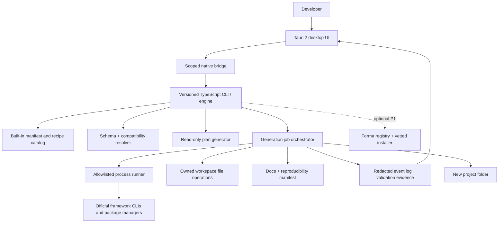
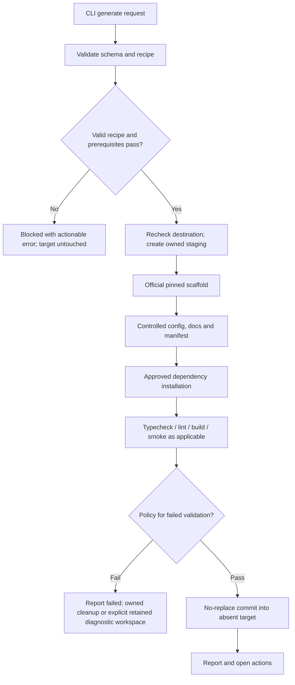

# Architecture — Universal Project Generator Desktop

| Field | Value |
|---|---|
| Version | V1 design draft 0.2 |
| Date | 2026-11-11 |
| Status | **Design draft; Phase 01 CLI implemented; architecture/release review pending** |
| Product baseline | [PRD](PRD.md) |
| Interface contract | [Adapter Contract](adapters/adapter-contract.md) |
| Compatibility source | [Compatibility Matrix](adapters/compatibility-matrix.md) |
| UX | [Design Specification](../design.md) |
| Decisions | [Decision Register](decisions/index.md) |

## 1. Goals and scope

Build a **Windows-first, local-first, CLI-first** project generator whose desktop app is a thin, secured client. Generate new repositories, never modify existing user projects. Technology choice is extensible through **versioned, built-in, reviewed adapters**; a catalog entry does not imply an executable recipe. One verified recipe is the unit of product availability and release qualification.

### Architecture invariants

1. Pure read-only `resolve/plan` must not run external commands, create directories, fetch network data, or access secrets.
2. Explicit `generate` intent is mandatory before any write/install/process operation. User sees the sanitized plan and prerequisites first.
3. No destructive overwrite. The final destination must be absent. No operation may clean files that lack generator ownership evidence.
4. Every official scaffold command uses an **exact resolved/pinned version** and explicit argv; package ecosystem is maintained per language. Do not use `@latest` as an effective execution pin.
5. One recipe = an explicit combination of adapters, options, support status, limitations, and evidence references; compatibility of ingredients alone is not sufficient.
6. Template providers, including Forma, are separate products. Reuse vetted installer contracts; no arbitrary remote plugin execution in V1.
7. Errors, skips, partial outcomes, and unverified toolchains must be reported truthfully.
8. UI cannot construct arbitrary executable names, shell snippets, or file writes. All privileged host operations pass through a validated bridge.

## 2. System context



Desktop UI will be introduced in a later phase. Phase 1 ships **Engine + CLI + built-in recipes** independently and is fully testable without Tauri. Implementation order must never turn the UI into an unstructured shell-command frontend.

### Phase 01 implementation snapshot

Current repository implements two npm workspaces: `packages/core` owns schema/resolution, plans, doctor, generation jobs, process execution, staging and project docs; `packages/cli` owns command parsing and JSON/JSONL output. No Tauri UI, backend/database adapters, Forma integration, or Node sidecar packaging exists. FE-01/FE-02 generation has local Windows evidence but recipes remain `planned`; normal generation blocks them. `--development-allow-planned` is an evidence-gathering switch, not a support-status override.

## 3. Proposed repository boundaries

```text
project-generator/
├── apps/
│   └── desktop/                 # Later: Tauri shell, React wizard, settings, job console
├── packages/
│   ├── config/                  # Shared schema, normalization, config migration
│   ├── catalog/                 # Built-in adapter and recipe manifests, release metadata
│   ├── core/                    # Resolver, plan, events, job state, staging/finalize
│   ├── adapters/                # Reviewed bundled framework/toolchain adapters
│   ├── cli/                     # CLI entrypoint: plan, doctor, generate, inspect
│   └── docs-generator/          # Generated docs templates and evidence-aware content
├── tests/
│   ├── unit/
│   ├── integration/
│   └── windows/                 # Path, cancellation, cleanup, real-scaffold evidence
├── docs/
│   ├── PRD.md
│   ├── ARCHITECTURE.md
│   ├── ROADMAP.md
│   ├── adapters/
│   ├── decisions/
│   ├── qa/
│   └── implementation/
├── AGENTS.md
├── agent.md
├── decision.md
└── design.md
```

This is the **proposed future directory shape**. Current implementation is narrower: root npm workspaces contain `packages/core` and `packages/cli`; config, catalog, adapters, and docs generation currently live within `core`. The root internal and generated-project package manager are both npm. Do not infer that proposed packages or desktop components exist.

### Package responsibilities

| Package | Owns | Must not do |
|---|---|---|
| `config` | Versioned schemas, parsing and normalization | Access disk/network or launch processes during schema validation |
| `catalog` | Adapter metadata, recipe status, version pin maps | Assume arbitrary cartesian combinations supported |
| `core` | Resolve → plan → preflight → execute, file ownership, jobs | Hardcode a framework's install commands into generic orchestration |
| `adapters` | Framework-specific steps, artifacts and checks | Delete other adapter files or invoke arbitrary unregistered commands |
| `cli` | Parsed subcommands, JSON output, exit codes, redaction | Contain product business logic |
| `docs-generator` | Real stack-specific docs and reproducibility metadata | Fabricate approval history, passing QA results or working DB connections |
| `desktop` | View/state, user intent, scoped OS host bridge | Execute user-supplied shell code directly |

## 4. Logical domain model

- `ProjectSelectionV1`: user-entered choices; untrusted until schema validated.
- `AdapterManifestV1`: versioned bundled capability and prerequisites metadata.
- `RecipeManifestV1`: explicit allowed combination, expected files, compatibility status, QA evidence, platform.
- `ResolvedSelection`: canonical, immutable combination of normalized choices and exact adapter versions.
- `GenerationPlan`: serializable steps, pinned scaffold sources, expected paths, optional downloads, consent flags, warnings; no secrets.
- `EnvironmentReport`: discovered executable versions and missing tools (read-only inspection with bounded command probes).
- `GenerationJob`: single owned execution, phase/event stream, cancellation signal, staging ownership marker.
- `JobReport`: step outcome, validation outcome, cleanup status, target impact and recovery instructions.
- `ReproducibilityManifest`: recipe ID and version, exact resolved upstream versions/hashes, package managers, actual generated lockfiles, validation statuses, no machine secrets.

The [Adapter Contract](adapters/adapter-contract.md) defines the broader proposed model. Phase 01's canonical types and strict parser live in `packages/core/src/types.ts` and `packages/core/src/schema.ts`; the CLI uses them directly. Desktop-side validation does not yet exist.

## 5. Execution protocol

### 5.1 Commands and invocation

Phase 01 CLI interface (implemented):

```text
project-generator catalog --json
project-generator plan --config <path> --json
project-generator doctor --config <path> --json
project-generator generate --config <path> --jsonl [--development-allow-planned]
project-generator inspect --output <path> --json
```

- `catalog`: built-in metadata only, no network.
- `plan`: schema validate, resolve recipe, render immutable plan and expected output; **no filesystem modification and no external execution**, with optional strictly read-only local config file read.
- `doctor`: inspect the active Node runtime, npm CLI beside it, platform and target-path safety. No installs, subprocess probes or target changes in Phase 01.
- `generate`: revalidate config and destination immediately before execution; ask for explicit execution intent at the UI layer or CLI invocation; emit streaming structured job events. `generate` is allowed to create its own staging workspace and use official package tooling.
- `inspect`: read generator-owned output metadata without modifying the generated project; do not infer build readiness from metadata alone.

CLI output contract: a stable JSON error envelope for JSON mode and newline-delimited event records for generation; diagnostics go to stderr in readable mode. Standard exit categories should distinguish invalid selection, missing prerequisite, generation failed, validation failed, cancelled, and blocked destination. Version these contracts and test consumer resilience.

### 5.2 Pipeline



The exact order of documentation and dependency operations may differ by recipe, but event semantics and destination safety are invariant. **No output is labeled Ready if required checks fail.** For Phase 1, validation failure defaults to **not committing** the new target; preserve redacted logs outside staging, clean only owned staging, and provide retry guidance. Diagnostic staging retention is optional and opt-in later.

### 5.3 Ownership and finalization

Target example: `E:\Projects\my-app`; parent must exist and user must have access. Proposed staging layout **on same volume**:

```text
E:\Projects\
├── .project-generator-stage-<random>/
│   ├── .ownership.json         # job UUID and owned path marker
│   └── my-app/                 # official scaffold uses real project name
└── my-app/                    # MUST be absent until successful commit
```

- Verify destination absent before stage and **again just before commit**.
- Phase 01 uses fixed PowerShell code to call `.NET Directory.Move` with source/target supplied as environment values; never use overwrite/replacement flags. Unit tests cover target creation before finalization; broader race review remains open.
- A staging marker alone is not authority to delete arbitrary contents: ownership must match the exact canonical staging path, job UUID and creation record; guard against swapped junctions/symlinks.
- Recheck path boundaries and canonicalization before mutating files. No `..` traversal, drive-root target, reserved Windows names, or reparse-point escape.
- Cancellation/crash must not erase preexisting user directories. Report orphan staging cleanly; never auto-delete unverified folders.
- A cross-volume rename is not assumed atomic; keep stage under chosen target's parent. Failure to create a safe same-volume stage blocks generation.

### 5.4 Process execution and cancellation

- Registry-controlled executable identity + argv list, not concatenated shell strings; whitelist permitted env keys, set controlled cwd, redact logs.
- Phase 01 resolves npm's CLI JavaScript under the active Node installation, then invokes reviewed JavaScript entrypoints through `node` with explicit argv and `shell: false`; executable and cwd roots are checked and the child environment is reduced.
- Phase 01 cancellation uses Windows `taskkill.exe /PID <pid> /T /F` for the owned child tree, with a Windows descendant test. It does not use a Job Object; broader process-race and security review remain open. See proposed [DEC-014](decisions/DEC-014-windows-process-runner.md).
- Secret values remain in private runtime memory / secure store, never argv or logs when the tool accepts safer mechanisms.
- Lifecycle scripts in dependency packages can execute code: disclose at Review and provide no false 'sandboxed' claim.
- Network access occurs only in generation or explicitly requested registry sync, not in plan.

### 5.5 Configuration and provenance

Sample **illustrative** user selection:

```json
{
  "schemaVersion": 1,
  "project": { "name": "sample-web", "type": "frontend", "parentDirectory": "E:\\Projects" },
  "frontend": { "adapterId": "frontend.react-vite", "language": "ts", "manager": "npm" },
  "styling": { "adapterId": "styling.css" },
  "documentation": "minimal",
  "git": { "initialize": false, "initialCommit": false }
}
```

The example follows the proposed `ProjectSelectionV1` shape; the resolver derives `FE-01` from the selection and the reviewed recipe registry. Concrete adapter IDs must be reconciled to implemented manifests before CLI usage. Persist no user secrets, auth tokens, or generated `.env` values. A project artifact such as `.project-generator/manifest.json` captures generator version, recipe ID, selected values, resolved versions and check outcomes; do **not** write absolute private home paths or credentials.

## 6. Adapter architecture and compatibility

Use one stable manifest per adapter + one reviewed recipe manifest per releaseable configuration. Resolution steps:

1. Validate project type and schema.
2. Map selected framework(s) to bundled versioned adapters.
3. Validate target OS and exact pinned CLI versions.
4. Validate npm default (Node ecosystem); Go Modules / Composer / uv remain independent.
5. Validate styling and component choices; Bootstrap is web-only, Expo/Flutter use native styling.
6. Validate DB/ORM/driver combinations and service provisioning mode.
7. If Forma selected, validate manifest, target renderer/adapter, package manager and pinned SHA.
8. Resolve to a named recipe with a QA-backed support state; do not automatically swap technologies.
9. Return a plan or actionable blocked reason.

`tested` requires per-recipe Windows evidence; status is release data promoted by reviewers/CI, **not set automatically after one run**. The Phase 01 CLI vertical slice implements only `FE-01` and `FE-02`. Both remain `planned` despite successful local Windows generation/build/smoke evidence; normal generation blocks them until independent acceptance and review. Evidence links are in the [compatibility matrix](adapters/compatibility-matrix.md).

## 7. Deployment/runtime choice and open PoC

| Boundary | Phase 1 choice | Desktop release candidate |
|---|---|---|
| Engine implementation | TypeScript CLI built for **system Node.js** | Same CLI contract reused |
| Native shell | Not required | Tauri 2 + Rust |
| Engine launch | Local `node <built-cli>` | Bundled Node runtime/sidecar **or** detected system Node after Windows PoC |
| UI ⇄ engine | CLI JSON/JSONL events | Validated Tauri command API / scoped sidecar bridge |
| Persistence | Project artifacts, local redacted job reports | JSON settings/history first; SQLite only if justified |
| Credentials | None needed in FE-01/FE-02 | Windows secure credential store for optional Forma auth |

**OPEN-001 remains unresolved:** do not claim the distributed desktop app can run on a PC without Node until packaging PoC passes on a clean Windows machine. Tauri plugin-shell limits command and argument scopes; keep the ultimate OS process privileges narrowly scoped (see https://v2.tauri.app/reference/javascript/shell/). Any custom native bridge must have equivalent validation.

## 8. Future Tauri desktop contract

The desktop layer sends only typed intents (`getCatalog`, `resolvePlan`, `runDoctor`, `startJob`, `cancelJob`, `getJobReport`, `openGeneratedFolder`). Host methods revalidate input; UI-side validation is user experience, not a security boundary. Subscribe to versioned progress events. When the window is closed during a job, the runtime policy must be explicit (prefer graceful cancellation for V1, never hidden background execution). Do not enable arbitrary filesystem/dialog/shell/URL permissions globally.

Proposed persistent settings (later): default parent path, preferred theme, preferred npm manager, last selected docs mode, recent recipe IDs. Project history is metadata only; no project source indexing. Telemetry disabled by default.

## 9. Error taxonomy and recovery

| Code (proposed) | Stage | Meaning / next action |
|---|---|---|
| `GEN_CONFIG_INVALID` | plan | Invalid schema/unknown field; correct config |
| `GEN_RECIPE_UNTESTED` | resolve | No allowed tested or explicitly experimental recipe; choose supported preset |
| `GEN_TOOL_MISSING` | doctor | Required installed executable absent; install exact dependency |
| `GEN_TOOL_UNSUPPORTED` | doctor | Installed tool version outside recipe range |
| `GEN_PATH_UNSAFE` | preflight | Invalid/unsafe Windows path; choose different empty destination |
| `GEN_PATH_EXISTS` | preflight/finalize | Target became occupied; do not overwrite |
| `GEN_SCAFFOLD_FAILED` | scaffold | Official CLI failed; logs show exit code and safe next step |
| `GEN_INSTALL_FAILED` | install | Package install failed; include registry/network possibility |
| `GEN_VALIDATE_FAILED` | validate | Build/lint/smoke failed; not Ready |
| `GEN_CANCELLED` | any execution phase | Stop owned work and report cleanup status |
| `GEN_STAGING_LEFTOVER` | cleanup | Retained owned temporary path, manual recovery instructions |
| `GEN_INTERNAL_ERROR` | any | Unexpected bug; redacted diagnostic ID |

Never return a generic success if stage validation is not run. A successful build is not proof of a functioning database or live website; expose each check separately.

## 10. Security and supply-chain boundaries

Threats: malicious project name/path; compromised manifest/registry; argument injection; dependency lifecycle scripts; symlink/junction swaps; secrets in diagnostics; TOCTOU target race; unauthorized Docker/GitHub actions. Mitigation: schema and length limits, path canonicalization and reparse-point checks, exact allowlisted processes, pinned hashes, scoped credentials, no arbitrary executable plugins, generate in owned workspace, deterministic cleanup policy, no hidden network/elevated operations. These controls require Windows evidence; design text alone is not a verified mitigation.

Forma private access is optional P1 and cannot be implemented until access contract and safe credential path are agreed. Never require Forma to generate an ordinary React or Next starter.

## 11. Quality and performance instrumentation

- Unit tests: schema/resolver/pure plan/event transitions/Windows path validation.
- Integration tests: fake executables and fixture adapters, fault injection per phase, cancellation, path race simulation.
- Windows E2E: local runs used pinned Vite/Next scaffolds, npm install, required checks, HTTP-served HTML smoke, and a parent path containing spaces and Unicode. Per-recipe reports are linked from the [QA matrix](qa/acceptance-matrix.md); clean-machine, broader adversarial and independent review gates remain open.
- Performance: measure cold plan time, actual generation/install duration and peak memory, but do not declare arbitrary SLA before baseline evidence.
- Evidence: record versions, commands (redacted), check statuses, timestamps, exit codes and report hashes; no credentials.

Acceptance rules: [QA Matrix](qa/acceptance-matrix.md); release roadmap: [Roadmap](ROADMAP.md).

## 12. Architectural decisions needing confirmation

- DEC-003: built-in reviewed adapters rather than untrusted runtime plugins.
- DEC-006: Tauri 2 UI and TS CLI split.
- DEC-011 (new proposal): Phase 1 system Node; Windows packaging PoC before desktop release.
- DEC-012 (new proposal): owned same-volume staging plus no-replace finalize.
- DEC-013: CLI JSONL event contract and future typed desktop bridge.
- DEC-014 (proposal): Node-invoked allowlisted JS tools and Windows `taskkill` process-tree cancellation.

See individual records in `docs/decisions/`. None of these proposals are a formal implementation approval or actual test result.
