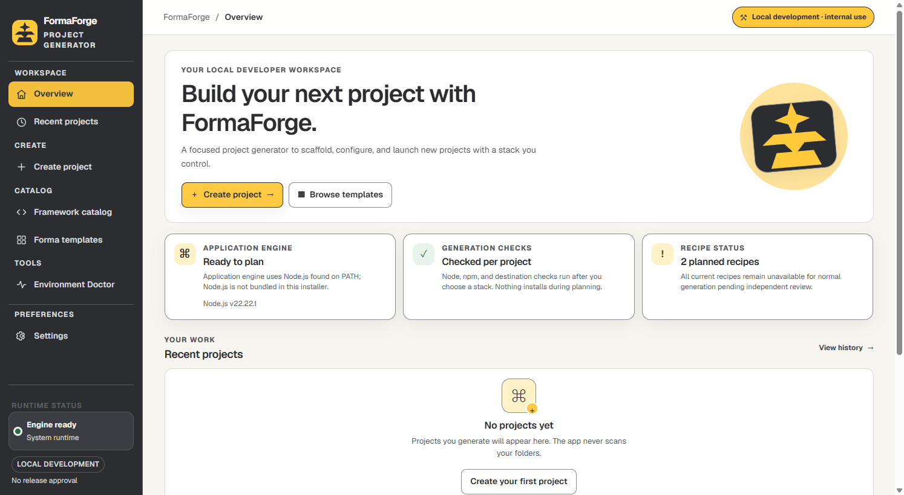
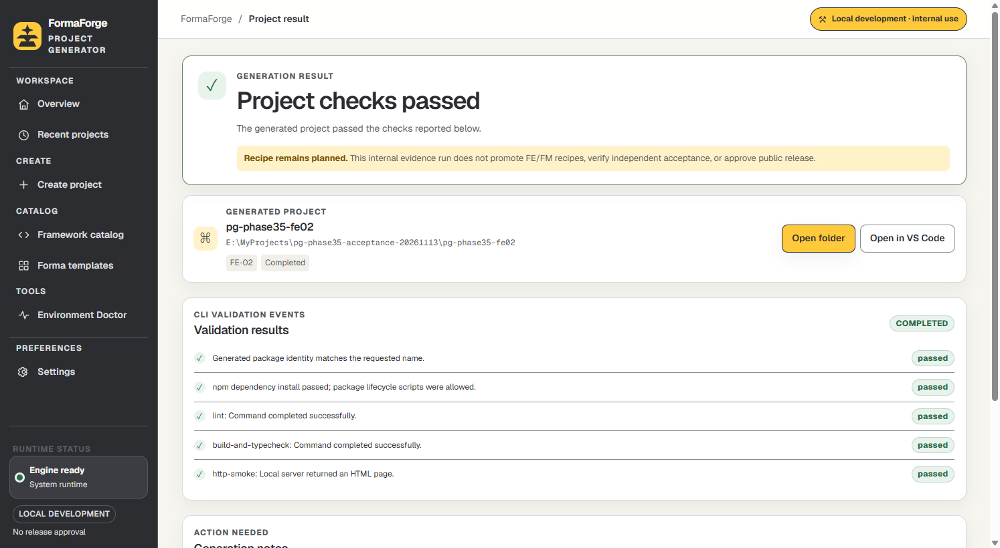

# Phase 03.5 — Final Desktop UX Polish and Functional Acceptance

| Field | Value |
|---|---|
| Status | **PARTIAL — requested native desktop flows verified; full product acceptance and release approval remain open** |
| Date | 2026-11-13 |
| Baseline | `3ce0cb531a552bd1551758888883c54e7dad110e` |
| Host | Windows 11 Pro `10.0.26300`; x64; 100% scaling (`devicePixelRatio=1`, AppliedDPI 96) |
| Tooling | Node.js `22.22.1`; npm `10.9.4`; Rust/Cargo `1.99.1`; Edge WebView2 `157.0.4341.46`; Tauri `2.12.4` |
| Test target root | `E:\MyProjects\pg-phase35-acceptance-20261113` (new isolated root; retained after testing) |

## Scope and changes

Corrected ten malformed `line-height: var(--line-token).number` declarations in `packages/desktop/src/style.css` to use existing typography tokens. A native 1500×820 screenshot showed the dashboard's “Create your first project” button clipped below the viewport; scoped reduced vertical padding to the dashboard empty state. Follow-up native measurement placed button bottom at 819.3px in an 820px viewport. FormaForge branding, Forge Studio colors, Geist fonts, generation guards, adapters, and recipe status did not change.

Added regression tests requiring every `line-height` declaration to reference a defined typography token and keeping compact padding scoped to the dashboard empty state. FE/FM recipes remain `planned`; these internal UI runs do not establish recipe acceptance or release readiness.

## Native Windows results

Tauri debug app ran at medium integrity with the system runtime. Review showed both lifecycle consent and internal planned-recipe override unchecked; each generation started only after both were affirmatively checked in the native UI.

| Flow | Observed result |
|---|---|
| FE-01 retry — React + Vite, Plain CSS, npm, Standard docs | `create-vite@9.3.4`; UI terminal `completed`. Scaffold identity, dependency install, lint, typecheck, build, and HTTP smoke all passed with exit code `0`. Manifest records lockfile SHA-256 `ef6086a6fdf5fcc1d51ffd20f1554065cfbd887700e618689207e989c377f172`. Recipe status at creation: `planned`. |
| FE-02 — Next.js App Router, Tailwind CSS, npm, Standard docs | `create-next-app@16.4.6`; UI terminal `completed`. Scaffold identity, dependency install, lint, build-and-typecheck, and HTTP smoke all passed with exit code `0`. Manifest records lockfile SHA-256 `d95dc0926e9d063539aec8f65b0fea95a060b9fec700fb039eac14d6b228752f`. Recipe status at creation: `planned`. |
| Error and retry | FE-01 target was occupied after review. Native generation returned `GEN_PATH_EXISTS` / “Destination already exists.” No overwrite occurred. Retry with a fresh FE-01 target completed successfully. |
| Target collision | Native Doctor reported `BLOCKED`; Generate stayed disabled. Pre-existing test sentinel SHA-256 remained `D06B5ADBD934290D5EA766E919D9C974C4A5C72194D4E6F737A8B03119C5DDE4`. |
| Cancellation | Native FE-01 job emitted live CLI events, then reached `Generation cancelled`. Requested target remained absent; read-only recovery inspection returned no pending work. |
| Result, history, open actions | Completed result screens showed validation outcomes. FE-01 and FE-02 appeared in local history. Explorer and VS Code actions opened generated folders from result/history; no UI error notice appeared. |
| Accessibility and keyboard | Six sidebar items were traversable by Tab with visible 3px focus; Space activated Settings. Button-name scan found zero unnamed buttons. Reduced motion limited animation/transition to `0.01ms`; light/dark theme persistence passed. Token contrast tests passed. |
| Responsive and scaling | Seven pages had no horizontal overflow at 760×640. Emulated DPR 1.25 and 1.5 had no tested title, lead, navigation, or document overflow at 1500×820. Actual Windows scaling was 100%; real 125%/150% scaling was unavailable. |

## Screenshots

Native WebView captures; test destinations contain no user-profile path.

Additional captures: [dashboard with generated history](phase-03.5-desktop-acceptance/dashboard-light.png), [dark dashboard](phase-03.5-desktop-acceptance/dashboard-dark.png), [FE-01 review](phase-03.5-desktop-acceptance/fe01-review.png), [FE-02 review](phase-03.5-desktop-acceptance/fe02-review.png), [generation progress](phase-03.5-desktop-acceptance/generation-progress.png), [collision error](phase-03.5-desktop-acceptance/generation-error.png), [blocked target review](phase-03.5-desktop-acceptance/target-collision-review.png), [cancellation progress](phase-03.5-desktop-acceptance/cancellation-progress.png), [cancellation result](phase-03.5-desktop-acceptance/cancellation-result.png), [project history](phase-03.5-desktop-acceptance/project-history.png), and [keyboard focus](phase-03.5-desktop-acceptance/keyboard-focus.png). Layout measurements are in the [layout-check record](forge-studio-redesign/layout-check.json).

## Automated checks

| Command | Result |
|---|---|
| `npm run test --workspace @project-generator/desktop` | Exit 0 — 14 passed, 0 failed |
| `npm run typecheck` | Exit 0 — core, CLI, desktop |
| `npm run lint` | Exit 0 |
| `npm run build --workspace @project-generator/desktop` | Exit 0 — TypeScript and Vite production build |

## Remaining limitations

- Actual Windows 125%/150% DPI and screen-reader/full live-region behavior were not tested; DPR emulation is not a substitute.
- Cleanup-failure UX, full error taxonomy, and independent security/product review remain open. npm lifecycle scripts ran unsandboxed after explicit consent.
- Full workspace `npm test` and packaged Tauri installer build were not rerun in this phase. Clean-machine packaging and release review remain open.
- FE-01, FE-02, FM-01, and FM-02 remain `planned`; public release remains **NO-GO**.
